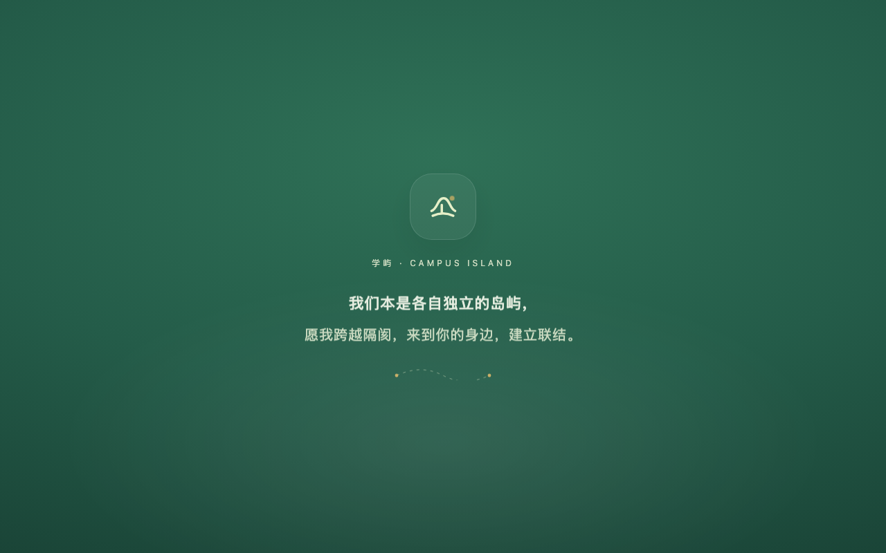
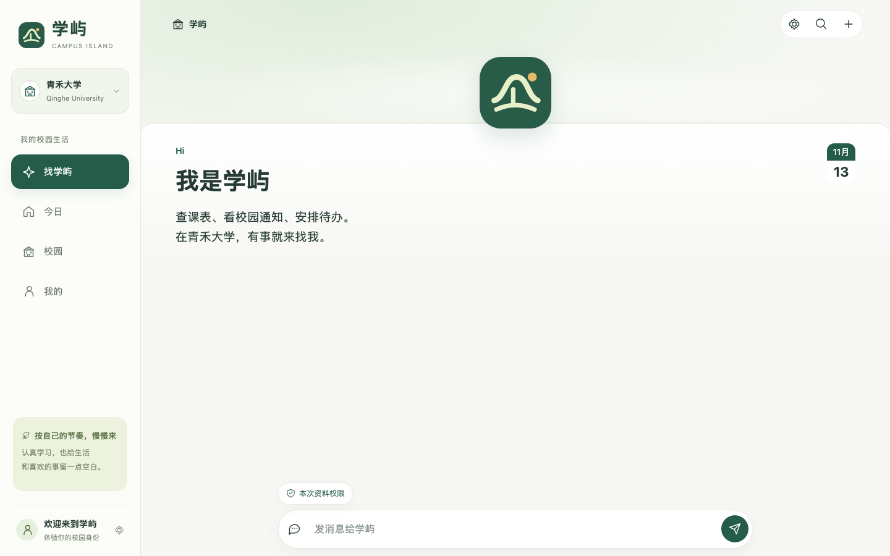
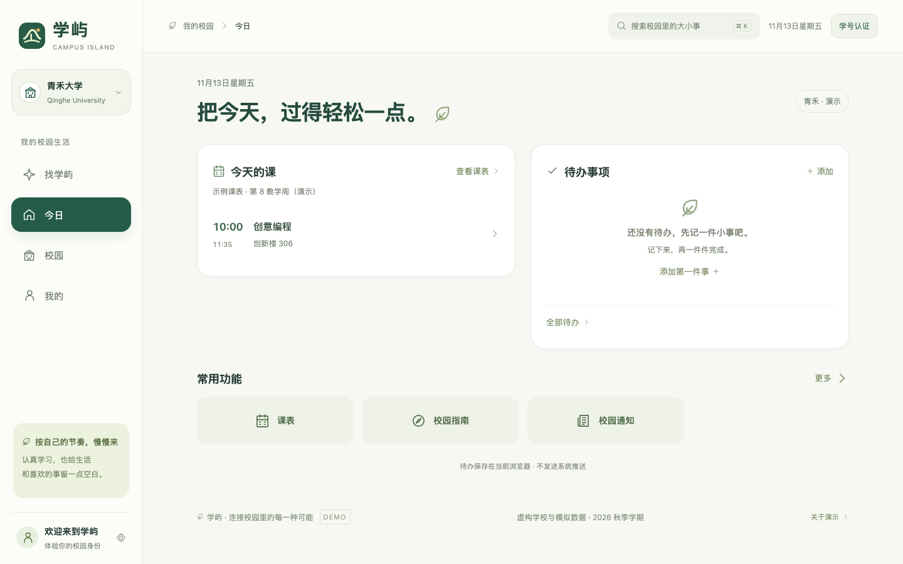
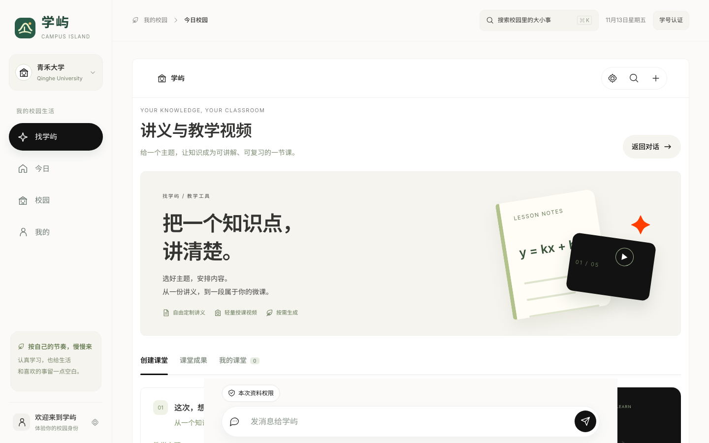
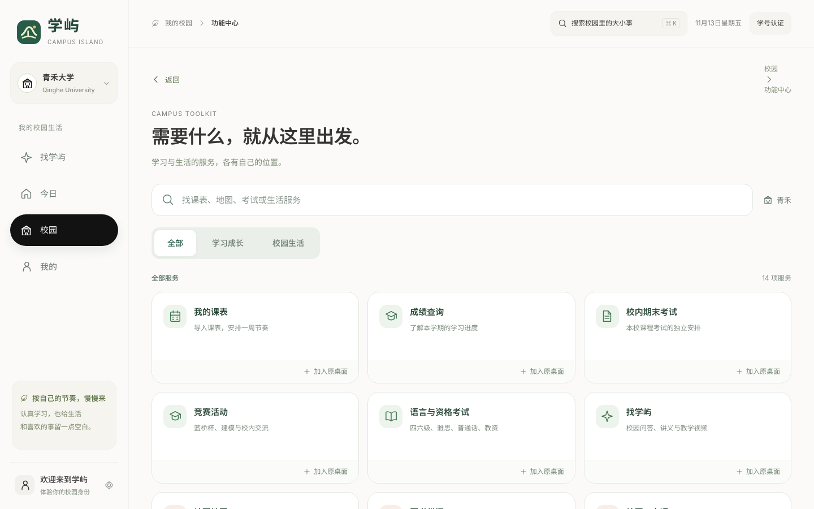
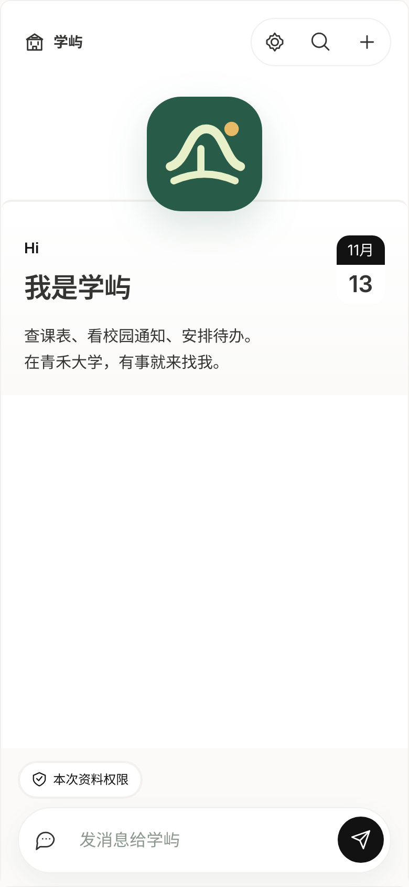
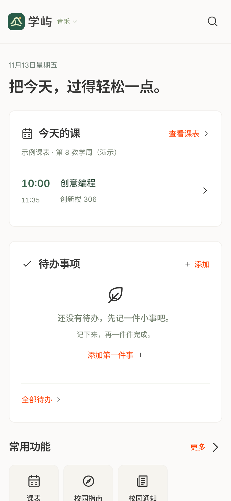
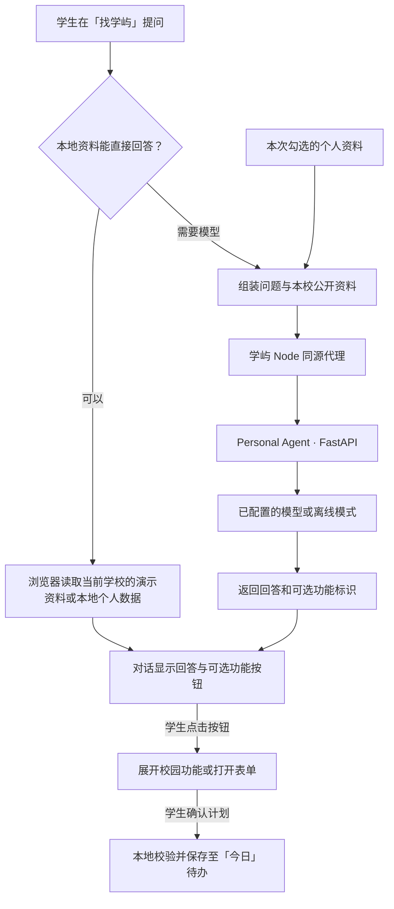

# 学屿 · 校园 Personal Agent

学屿是面向学生的校园助手原型。打开应用就能用自然语言查询课表、通知和社团活动，也可以把通知转成待办。助手先在对话中回答，再提供相关功能按钮。

> 在线演示（静态版）：https://mat11-oo.github.io/Personal-Schedule-Agent-for-campus/
>
> 静态托管只提供前端页面；课表、通知、待办、排程等本机功能可直接体验，对话与通知提炼需要按下方说明在本地运行完整服务。

[界面预览](#界面预览) · [快速开始](#本地运行) · [示例任务](#可以怎么问) · [架构与目录](#架构与目录) · [数据与隐私](#数据与隐私) · [开发与验证](#开发与验证) · [版权与许可](#版权与许可)

## 界面预览

<p align="center">
  
</p>

<p align="center"><sub>启动封面：约 1.5 秒后淡出进入首页</sub></p>

<p align="center">
  
</p>

<p align="center"><sub>「找学屿」：对话式首页，查课表、看通知、安排待办都在这里</sub></p>

<table>
  <tr>
    <td width="50%"></td>
    <td width="50%"></td>
  </tr>
  <tr>
    <td align="center"><sub>今日：今天的课、待办与常用功能</sub></td>
    <td align="center"><sub>讲义与教学视频：从一份讲义到一段微课</sub></td>
  </tr>
  <tr>
    <td width="50%"></td>
    <td width="50%" valign="middle" align="center"><sub>功能中心：课表、成绩、考试、竞赛与校园生活服务集中在一处</sub></td>
  </tr>
</table>

<p align="center">
  
  &nbsp;&nbsp;&nbsp;
  
</p>

<sub>截图来自本仓库的静态演示版（`dist/`），与桌面版共用同一套前端；内容均为演示数据。</sub>

## 对话首页

打开学屿会先进入「找学屿」。可以输入「看看我的课表」「查校园通知」「我要报修」，也可以展开功能列表。对话先显示回答及相关功能按钮。点击后，页面型功能在对话中展开，表单型功能沿用原有操作窗口。校园业务继续使用学屿的演示数据和权限。

常用指令在本机匹配。其他输入会发送给 Personal Agent，Agent 可以回答，或返回可用功能的标识。学屿只接受清单中的功能，提交操作由用户在原有界面完成。对话记录按学校保存在当前页面会话中。请求模型时附带当前学校相关的公开通知、指南、活动和社团资料。课表、未完成待办和已报名活动默认关闭，可按次选择发送。已发送的资料可能被 Agent 的会话或记忆功能保存。

## 通知计划卡与本机 Personal Agent

通过「校园 → 通知详情 → 帮我安排这件事」打开计划卡。默认尝试安排 30 分钟，可修改事项、开始时间和时长。确认后进入「今日」待办，并保留通知来源。课表按当前所选教学周检查，请核对它是否适用于目标日期。

可在计划卡中主动请求 Personal Agent 提炼建议。此操作发送该条公开通知的标题及最多 1800 字正文。Agent 返回有效的待办标题时，可点击「用作待办标题」填入计划卡，再编辑或确认。课表、排程和保存仍由学屿在浏览器内处理。

完整启动方式见下方。Agent 不可用时仍可使用本机计划卡。静态托管需要另行提供代理才能使用 Agent 建议。

## GitHub Pages 在线演示

仓库通过 `.github/workflows/pages.yml` 把 `dist/` 发布到 GitHub Pages。首次发布时在仓库 **Settings → Pages** 把 Source 设为 **GitHub Actions**，之后每次推送 `main` 会自动重新部署。站点地址为 https://mat11-oo.github.io/Personal-Schedule-Agent-for-campus/ 。页面使用相对路径与 hash 路由，可直接在该子路径下运行；`/api/personal-agent/*` 在静态托管中不存在，相关功能会提示暂时无法连接，其余功能不受影响。

## 1.8 对话首页与桌面版同步

- 启动时先出现约 1.5 秒的封面：「我们本是各自独立的岛屿，愿我跨越隔阂，来到你的身边，建立联结。」随后淡出进入首页。封面用 CSS 动画驱动，不依赖主线程定时器；系统开启「减弱动态效果」时缩短为 0.5 秒，无 JavaScript 时自动隐藏。
- 打开学屿直接进入「找学屿」对话首页：一句欢迎语、一个输入框，常用请求在对话里展开，功能页从对话中打开。导航为「找学屿、今日、校园、我的」。
- 手机端不再使用底部标签栏，改为点左上角「学屿」打开抽屉导航；对话页为沉浸式布局，输入框固定在底部。
- 「AI 学堂」并入「找学屿」，以「讲义与教学视频」工具页出现，顶部提供「返回对话」；模型配置入口在「我的 → AI 模型设置」。
- 本仓库的 `dist/` 与桌面版共用同一份前端：桌面应用只是 Swift 外壳，加载本机 `http://localhost:4173/#agent`，所以网页版、桌面版界面一致。之前 Pages 上的演示是旧快照（1.7），已同步到 1.8。
- 本机服务新增 `POST /api/personal-agent/model-settings` 与 `POST /api/personal-agent/lesson`，模型密钥只写在本机 `personal-agent/data/xueyu-model-settings.json`，不会进入前端或仓库。
- 验证：`npm run check` 与 12 项 `node --test` 全部通过。

## 1.7 简洁首页与个人助手

- 主导航改为「今日、校园、我的」，全局「找学屿」打开轻量助手；首页展示今日课程、待办和常用入口，校园页集中通知、活动、社区与服务。
- 通知详情支持加入待办：先核对事项与可选截止时间，再确认保存，并保留来源。同一通知重复添加时打开已有待办；缺少明确日期时保留空白，过期日期提示核对。
- 支持添加、修改、完成与恢复待办，刷新后保留，按学校保存；不再自动展示旧版固定的示例提醒，用户创建的数据保留。
- 一句话排程采用本机规则，支持今天、明天、后天、周几、YYYY-MM-DD、数字时刻及数字小时/分钟。例如「明天下午安排复习高数1小时」。普通待办默认 30 分钟，可修改。预览时避开当前教学周课程和已安排待办，保存时再次检查冲突及已知截止时间。关闭预览不会保存。
- 这不是开放式自主 Agent。其他问题转入原 AI 问答草稿，由用户发送，继续沿用原模型配置和资料授权。未调用真实模型验证。
- 原自定义桌面在「我的 → 原自定义桌面」，数据与编辑能力保留；原服务布局仍可从 #service-layout 访问。服务目录添加的快捷入口保存在原自定义桌面。
- 仍为浏览器本地演示，不跨设备同步、不发送系统推送、不代办真实校园业务；未导入课表时明确展示示例课表与演示教学周。
- 验证：语法检查与现有 12 项检查通过；Chrome 验证导航、排程确认、冲突阻止、取消不保存、刷新保留、通知日期提取与重复添加、任务完成及手机布局。未新增测试脚本。

面向学生的校园服务交互原型。学屿界面使用原生 HTML、CSS、JavaScript，Personal Agent 后端随项目一并提供。

## 本地运行

准备 Node.js 22+ 和 Python 3.12，在此目录运行：

```bash
npm start
```

首次启动会在 `personal-agent/.venv` 安装锁定的 Python 依赖，并生成本机身份密钥。命令会同时启动学屿和项目内的 Personal Agent。打开终端显示的学屿地址，按 Ctrl+C 可停止两个服务。

- 学屿默认使用 `4173`，Agent 默认使用 `18787`。可通过 `PORT` 和 `PERSONAL_AGENT_PORT` 指定备用端口。
- 模型配置放在 `personal-agent/.env`，参考该目录的 `.env.example`。未配置模型时，Agent 使用离线模式。其运行数据默认保存在 `personal-agent/data/`。
- 只开发界面时，可使用 `npm run dev`。如果另行启动 Agent，通过 `PERSONAL_AGENT_PORT` 指定对应端口。
- 随项目纳入的是 Personal Agent 0.8.2，源码、依赖锁和 MIT 许可保存在 `personal-agent/`。

## 可以怎么问

| 请求 | 应用如何处理 |
| --- | --- |
| 今天有什么课？ | 根据当前所选教学周和课表列出课程，并提供课表入口。 |
| 学校有哪些社团活动？ | 从当前学校的演示资料中列出活动时间和地点。 |
| 这条通知帮我安排一下 | 在通知详情点击「帮我安排这件事」，查看并编辑计划卡，确认后保存。 |
| 结合我的课表和待办，明天下午有没有空？ | 在输入框下方按次勾选课表和待办，交由已配置的模型结合资料回答。 |

## 架构与目录

浏览器访问学屿的 Node 服务。校园页面和本地排程在浏览器运行，聊天请求经同源代理发送给本机 Personal Agent。Agent 使用独立会话，并通过配置的模型处理对话。推荐功能只能从学屿的功能清单中选择，用户点击后打开页面或表单。

| 路径 | 内容 |
| --- | --- |
| `dist/` | 学屿页面、演示数据、对话、排程和校园模块 |
| `server.mjs` | 学屿静态服务，以及 Personal Agent 的会话、聊天、模型设置和讲义生成代理 |
| `start.sh` | 安装锁定依赖并启动两个本机服务 |
| `personal-agent/app/` | FastAPI、Agent 工作流、模型网关和记忆 |
| `personal-agent/.env.example` | 可提交的配置模板 |
| `test/` | 学屿模型接入和 AI 学堂的自动测试 |

### 工作原理



课表、未完成待办和已报名活动默认不随模型请求发送。用户按次勾选后，所选资料才会加入该次请求。

### 配置模型

先运行一次 `npm start` 生成 `personal-agent/.env`，保留其中的 `AUTH_SECRET`。使用 Kimi 时，可按模板填写 `KIMI_API_KEY`，其他兼容服务可配置 `LLM_FAST_*` 和 `LLM_STRONG_*`。保存后重启。详细字段见 [模型网关说明](personal-agent/docs/llm-gateway.md)。

对话首页（找学屿）与「讲义与教学视频」都使用本机 Personal Agent 的模型。在「我的 → AI 模型设置」或对话页右上角齿轮里选择服务商、填写 API Key，保存时经 `/api/personal-agent/model-settings` 写入本机 `personal-agent/data/xueyu-model-settings.json`：不写 localStorage，不进仓库，也不回显明文。讲义生成走 `/api/personal-agent/lesson`，同样由本机服务转发。

视频配音仍沿用浏览器内已有的语音模型与音色配置；该配置只用于配音，不影响对话与讲义生成。

## 数据与隐私

- 校园资料来自虚构学校。当前没有真实学校官网检索、学籍验证或教务接口。
- 学屿的课表、待办和偏好保存在当前浏览器，按学校区分。不同端口对应不同浏览器存储空间。
- 调用模型时会发送用户输入及相关公开校园资料。课表、未完成待办和已报名活动默认关闭，用户可按次选择。已发送内容可能进入 Agent 会话或记忆，也可能由所配置的模型服务处理。
- Personal Agent 的环境文件、本机数据库、密钥和托管配置应留在本地。公开发布时仅提交脱敏的环境模板。
- 两个服务默认监听本机回环地址。部署到公网需要另行配置 HTTPS、认证和数据管理。静态托管只提供页面，完整对话需要 Node 代理和 Python 服务。

## 开发与验证

```bash
npm run check
npm test
```

如果页面可用但 Agent 回复失败，可先确认通过 `npm start` 启动完整项目，再检查终端中的 Agent 启动日志和模型配置。遇到端口占用，可分别设置 `PORT` 和 `PERSONAL_AGENT_PORT`。安装依赖需要可访问的软件源或可用的本地缓存。

提交前可用 `git status --short --ignored` 核对本地配置和运行数据确实被忽略，用 `git diff --cached --stat` 确认待发布文件范围，并检查提交作者和签名信息。

## 版权与许可

本项目采用 [MIT 许可证](LICENSE)，版权署名为 Mat11-oo。仓库内 Personal Agent 组件的许可证也保存在 [组件目录](personal-agent/LICENSE)。

## 可体验的流程

- 切换青禾大学与南川理工大学，查看分别组织的校园内容。
- 使用预填示例学号体验模拟认证（无需密码、不验证真实学籍）。
- 浏览整周课表与课程详情，切换教学周。
- 模拟教务同步，或导入 CSV / JSON 课表；导入前预览并验证字段。
- 筛选、搜索与收藏学校、学院和社团通知。
- 浏览活动，报名 / 取消报名，关注 / 取消关注社团。
- 搜索生活指南，查看地点、时间和办理步骤并收藏。
- 查看我的校园、报名日程和收藏，添加与完成待办，调整提醒偏好。
- 体验成绩、图书、校园卡、校车和报修服务的模拟界面。

## 演示边界

两所学校均为虚构学校。身份、成绩、通知、课表、电话、服务和活动均为示例，不代表真实高校数据或安排。认证与教务同步是本地模拟，没有接入真实学校官网或系统，也不会收集教务密码。所有个人状态保存在当前浏览器的 localStorage 中，不跨设备同步，不具备真实认证或服务端学校数据隔离能力。通知偏好与课程提醒不会发送真实系统推送，校园卡没有真实支付功能，报修不会发送给维修人员。

## 课表导入

CSV 表头：`课程名称,教师,教室,星期,开始时间,结束时间`。

JSON 支持课程数组或 `{ "courses": [...] }`；课程字段为 `name, teacher, location, weekday, start, end`，可选 `period, weeks`。星期为 1–7，时间为 24 小时制 HH:MM。文件最大 1 MB、最多 100 门课程。默认周次为 1–16 周；周次可用 `1–16周`、`1–16周（单周）`、`1–16周（双周）`。

## 设计

森林绿与暖灰色，原创 SVG 校园及活动插画；桌面为侧边栏，手机收成抽屉导航（点左上角「学屿」打开），对话页为沉浸式整屏布局。

## 1.1 新增校园社区

- 卡通校园地图：原创 SVG 建筑与道路、地点分类和搜索、地点详情、南门到地点的示意路线、缩放。地图不使用真实地理坐标或定位。
- 校园论坛：本校话题、分类、搜索、热门排序、实名或匿名发帖、点赞、实名或匿名回复。匿名内容不渲染作者姓名、学院、学号或私聊作者入口；这仅是前台匿名展示演示，不能视为正式匿名安全系统。
- 校园私信：同校演示联系人、从非匿名话题发起私聊、消息发送、本地保存、主动触发模拟回复与联系人屏蔽。不会向真实用户发送信息，不提供跨设备同步或实时通信。
- 志愿中心：活动报名、模拟签到与签退、学时申报、记录筛选、CSV 导出、学期进度和个人页学时摘要。报名与申报不直接增加已确认学时；已确认记录为种子示例，新申报仅进入待审核。
- 社团公益活动与志愿报名相互关联，已进入服务流程的活动不可通过普通活动入口直接取消。
- 首页与个人页提供新模块入口，手机底部导航已在 1.3 更新为首页、功能、论坛、私信、我的。原课表、资讯、社团与指南仍可从首页和个人页进入。
- 新模块按学校分别保存至 `xueyu-community-demo-v1`，原 `xueyu-campus-demo-v1` 数据保留。

## 1.2 自定义模型 API 与问学屿

- 新增「问学屿」和「AI 模型设置」，支持多接入配置、自定义 Base URL、模型 ID、可选 API Key、读取模型列表、连接测试和模型切换。
- 使用 OpenAI Chat Completions 兼容格式，直接请求用户填写的 `/chat/completions`；可选择 `/models` 读取模型列表，不支持时可手动填写。服务商原生格式不兼容时，需要其兼容入口或用户自己信任的兼容网关。
- API Key 只保存在本页 JavaScript 内存的 Map 中，不写入 localStorage / sessionStorage、聊天记录、项目源码或学屿服务端。刷新后忘记密钥，也可手动清除。
- 本地只保存配置名称、地址、模型 ID、当前选项与公开资料偏好。对话仅存在本页内存，并按学校、模型配置和资料范围分别组织。
- 校园资料范围默认包含当前学校的公开示例指南、通知与活动。个人课表默认关闭，需已认证并主动选择；不附带姓名、学号、成绩、论坛帖子或私聊。关闭公开资料也不发送学校名称。
- 回答提供「本次提供的本校资料」入口，不把模型输出直接渲染为 HTML。模型没有报名、付款、发消息或审核学时的工具权限。
- 调用由用户自己的服务商账户计费。接口须支持浏览器 CORS；HTTPS 页面调用本机 HTTP 服务还受浏览器本机网络访问策略影响。
- 不自动测试、不自动读模型列表。连接测试只发送一条短消息，不附带校园资料。请求可取消，并在 90 秒后超时。
- `npm test` 验证地址限制、请求目标与参数、错误提示、密钥不落盘、刷新忘记密钥及默认资料范围。浏览器使用本机模拟 API 检查界面与请求流程，没有使用真实 API Key 或产生真实模型费用。

协议参考：DeepSeek 官方接入文档 https://api-docs.deepseek.com/ （OpenAI 兼容 Chat Completions）。

## 1.3 功能中心与成长资讯

- 手机底部「地图」替换为「功能」，卡通地图保留在功能中心与桌面侧栏。
- 功能中心整合校园兼职、二手交易、竞赛活动、考试资讯，以及课表、地图、志愿和论坛入口。
- 兼职支持分类、搜索、收藏、详情与同校演示私聊；岗位、单位和薪酬均为虚构示例。
- 二手交易支持分类、搜索、收藏、详情、认证后发布闲置、本人闲置下架与重新上架。数据按学校保存在当前浏览器的 xueyu-features-demo-v1，不提供真实交易、支付或多人同步。
- 蓝桥杯与全国大学生数学建模竞赛提供官方入口；校内交流活动明确标为示例。
- 四六级、雅思、普通话水平测试、教师资格考试在「考试资讯」展示，可查看准备事项并收藏，详情附官方入口。未内置未经确认的场次、报名日期、费用或资格承诺。官方入口核对于 2026-10-25。
- 「校内期末考试」使用独立路由与教务课程列表，需要演示认证；按当前学校的示例或导入课表列出课程，时间、考场与考核方式待教务发布，不混入语言与资格考试。
- 本次不新增测试脚本；使用语法检查和浏览器交互检查验证。

公开入口：蓝桥杯 https://dasai.lanqiao.cn/ 、全国大学生数学建模竞赛 https://www.mcm.edu.cn/ 、CET https://cet.neea.edu.cn/ 、雅思 https://ielts.neea.cn/ 、普通话 https://bm.cltt.org/ 、教师资格 https://ntce.neea.edu.cn/ 。

## 1.4 可自定义小组件桌面

- 首页与功能中心都提供自定义模式，可添加同类或不同类型的小组件，移除不需要的模块，拖动手柄排序，也可使用上移 / 下移按钮。
- 支持小、中、大三种宽度，自适应桌面四列和手机两列；手机中、大组件都占整行，桌面大组件占整行。
- 小组件包含校园寄语、课表、通知、社团活动、快捷入口、竞赛 / 考试 / 兼职 / 二手资讯、待办提醒与自定义便签。
- 每个模块可设置标题、配色、大小；按类型可选择星期、消息来源、活动分类、功能资讯来源、展示条数、1–8 个快捷入口或自由文本内容。
- 编辑使用内存草稿，支持撤销、预览、取消与恢复默认布局，点击保存后才覆盖当前学校的布局。
- 使用 xueyu-widget-layouts-v1 在当前浏览器按学校分别保存；切换学校会退出编辑并加载对应学校布局，不会同步到其他设备或真实学生账号。便签不发送到论坛或 AI。
- 原来的课表、官网资讯、社团、地图、论坛、私信、志愿和 AI 功能保留。语言 / 资格考试与校内期末考试保持独立。
- 本次不新增测试脚本，进行语法检查及浏览器交互检查。

## 1.4.1 常用校园服务排版修复

快捷入口内部网格使用独立类名 widget-shortcut-grid，避免与小组件容器 widget-shortcuts 的类型类名冲突。修复手机宽度和小尺寸下整个卡片被错误分列、标题竖排和入口重叠的问题；编辑模式下设置栏与移动按钮也保持独立整行。保存的布局、入口选择和组件顺序无需重置。

## 1.5 独立功能：AI 学堂

- 独立路由 `#teaching`，桌面侧栏、首页、功能中心及个人页均有入口，也可加入自定义快捷入口小组件。
- 创建课堂时可选择仅 PDF、仅视频或两者全选；设置主题、学段、教学目标、3 / 5 分钟时长，粘贴参考资料或导入 TXT / MD（不超过 100 KB、12000 字）。当前版本不自动联网检索，不解析 PDF / Office 文件，不读取课表、论坛或私聊。
- 教学板块支持勾选、添加自定义栏目、移除及上下排序，最多 14 个。提供学习目标、先修知识、核心概念、推导、例题、误区、练习、答案、小结与参考资料等选择。
- 提供明确标识的内置“一次函数”体验样例，无模型请求。任意主题的正式生成复用「AI 模型设置」中的当前接入，单次非流式请求返回共用的教学内容与视频分镜；仅 PDF 时不请求视频镜头。模型结果必须通过结构检查，错误、取消与 HTTP 失败均保留上一份成果，不自动重试。
- 所有模型输出作为纯文本 / JSON 数据处理，不执行生成代码，不渲染生成 HTML。API Key 继续仅留在已有 AI 模块内存中；教学模块不保存或复制密钥。生成请求附带可配置流程所需的输出长度上限。
- 课堂成果可分别编辑讲义板块与镜头标题、要点和旁白；两者独立编辑后请人工确认内容一致。修改镜头或替换录音会使之前的配音 / 视频失效，避免下载旧版本。
- PDF 使用本机画布排版并导出 A4 文件，支持中文、分页与页码，属于适合阅读打印的图像式 PDF；另可导出可编辑 Markdown，包含教学正文、分镜和旁白。
- 视频采用固定课件与逐条呈现要点的轻量形式，在浏览器本机合成；未运行完整 Code2Video / Manim 或 Presenton 服务，也未引入数字人或通用文生视频接口。浏览器朗读仅用于当前镜头预览，不会假装被录入导出文件。
- 配音可导入整课录音（20 MB 以内、最长 10 分钟），或主动调用当前接入的 `/audio/speech` 兼容接口，需填写该服务商真实支持的语音模型与音色 ID。原生格式不兼容时请导入录音；没有配置语音服务时不会自动调用。音频按旁白字数比例分配到各镜头，字幕时间为估算，未做精确强制对齐。
- 视频实际输出 WebM 或浏览器支持的 MP4，保留真实音轨，可在成果页预览下载；无录音时可明确选择生成字幕版。合成时间接近视频长度，需保持页面前台。导出过程可取消；已加入空文件检测与音视频轨道清理。
- 预算卡支持自行填写输入、输出、配音单价及提醒线。预填单价仅用于示例计算，并非所选模型的实时价格；超过估算提醒线时阻止新内容请求。该提醒不构成服务商扣费上限；配音、失败请求、人工修改、渲染、检索和存储的总费用不能保证低于 1 元。接口有返回时展示实际输入 / 输出 Token；缺失时明确标记未返回。
- 最近 6 课按学校保存在当前浏览器的 `xueyu-teaching-v1`，不含原始参考资料和密钥。录音、视频与创建表单仅保留本页会话，刷新后需重新准备。课程不自动发布或同步到其他设备。
- 验证：12 项自动检查通过；本机模拟接口验证了模型生成、配音、含音轨的 1280×720 视频播放、PDF 下载、编辑、错误保留、停止任务、仅 PDF 分支、历史恢复及手机布局。PDF 经 Poppler 检查、渲染与目视复核。未使用真实服务商密钥，未产生模型调用费用；实际模型质量、单课成本和线上浏览器兼容性仍需接入后验证。


## 1.6 学生校园界面与功能结构优化

- 桌面与手机统一为今日、功能、社区、消息、我的五个主入口。社区内分别查看同学广场、校院资讯、社团活动与志愿服务；消息内区分私信与个人事项提醒。
- 功能页改为唯一的 14 项学习 / 生活服务目录，可分类、搜索并主动固定首页。AI 问答、AI 学堂与模型接入共用一个工作区，保留各自的完整流程；期末课程考试仍与语言、资格考试分开。
- 首页新默认布局仅保留课程、待办、便签，课程可跟随上海时区当天星期，也可固定星期。已保存布局原样保留，旧功能页布局可从「我的服务布局」继续访问和调整。
- 固定首页会去重、提示已固定状态，并保护未保存草稿；小组件继续支持拖动、大小、内容、配色、预览与撤销。
- 个人页集中管理身份、收藏、报名、本人发布、关注与偏好；收藏统一显示通知、指南、竞赛、考试、兼职与闲置。
- 页面使用可返回的浏览器历史，按学校和页面恢复筛选与滚动位置。顶部显示实际上海日期，教学数据明确标注示例教学周。
- 清新暖白与学屿绿结合，社区适度使用珊瑚与丁香色；增大手机文字和触控范围，增加短过渡、按压与拖动反馈，支持减少动态效果偏好。志愿页取消统一的固定学时目标，突出真实参与与组织核验。
- 未新增测试脚本；通过语法检查、差异检查及浏览器交互与手机/桌面排版检查。真实校园接入、论坛多人同步与 AI 服务商调用边界沿用原演示说明。
